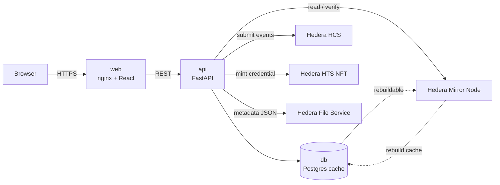
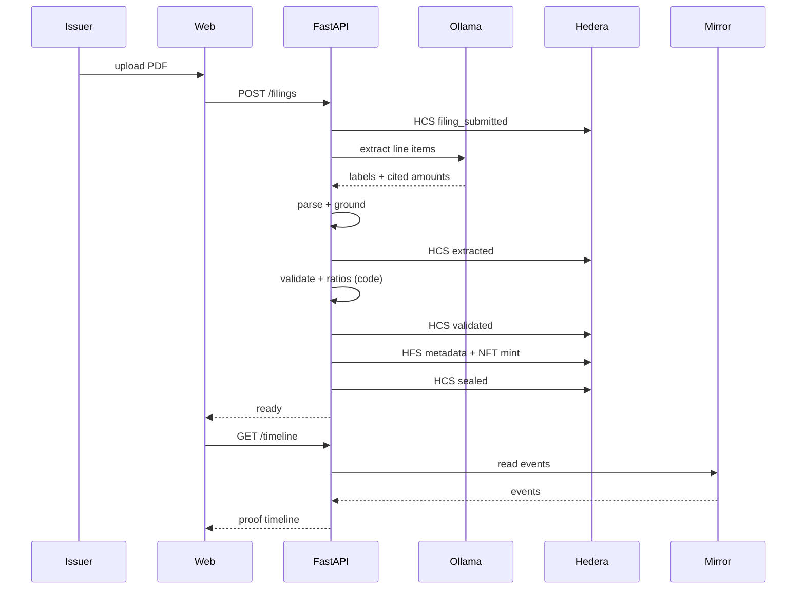

# Project Plan — Verified Financial Filings (working title)

Status: **DRAFT for approval**
Owner: Ahmed (technical lead) · Team: business model, diagrams, slides, presentation
Build window: 3 days (deadline Oct 24, 19:00)

---

## 1. One-line vision

> Brokers need trusted analysis before the market, and a defensible record of it.
> We turn a filing into verified, timestamped research where every number traces to
> the source and every report carries a proof anyone can check — with Hedera as the
> trust layer.

**Build principle — clean-room:** everything is written from scratch in this repo.
The previous project (`hackathon/`) is a **reference only**: no copy-paste, no
imports, no reuse of its files. Proven ideas may inform the design, but every module
(extraction, numbers, grounding, schemas) is re-implemented cleanly here.

## 2. Problem

Financial statements are published as PDFs. Once they leave the issuer:
- figures get re-typed by hand (errors, alterations, quiet restatements);
- analysis is slow, so the first mover advantage is lost;
- there is no audit trail to defend a decision to compliance.

## 3. Customer & value

- **Wedge:** independent brokers and research desks.
- **Expansion:** private firms; regulators/regulator nodes later.
- **Buyer:** head of research / compliance. **User:** analyst.
- **Value:** *speed + defensibility* — act first, and prove later that the numbers
  match the filing.

## 4. Why Hedera is load-bearing

The customer needs three things only a ledger gives cleanly:
1. a **trusted timestamp** ("we had it first");
2. **third-party verification** ("don't trust us, check it");
3. a **portable credential** (proof that travels).

- **HCS** = immutable, hash-chained event log → the source of truth.
- **HTS NFT** = one "Verified Filing Credential" per issuer-period.
- **HFS** = metadata JSON (NFT metadata field is only 100 bytes).
- **Mirror Node** = the read path; the app can rebuild itself from chain.

**Test of core-ness:** delete Hedera and the product stops working.

## 5. Moat (a path, not a claim)

1. **Network effect** — the verified registry grows more valuable with each filing.
2. **Trust standard** — "verified by us" becomes the mark compliance relies on.
3. **Switching cost + proprietary data** — integrations, correction history,
   golden dataset; a copycat starts at zero verified filings.

## 6. Architecture (3 containers)



- **db** (Postgres): index/cache only. **Wipeable and rebuildable from the mirror.**
- **api** (FastAPI): extraction, validation, ratios, Hedera client, mirror reader.
- **web** (nginx + React/Vite): thin display layer — login, filings, charts,
  timeline, credential, verify button. Never touches Hedera or holds keys.

## 7. On-chain design

### 7.1 HCS event model (one topic per filing)
Each message is canonical JSON, signed by the acting Hedera account, and chained:

| field | type | notes |
|---|---|---|
| `event_id` | uuid | unique |
| `event` | enum | `filing_submitted` · `extracted` · `validated` · `sealed` |
| `actor` | string | Hedera account ID |
| `role` | enum | `issuer` · `agent` · `verifier` |
| `sector` | string | reserved for future multi-sector |
| `doc_sha256` | hex | hash of the source PDF |
| `extraction_sha256` | hex | hash of the extraction result |
| `verdict` | enum | `pass` / `fail` / null |
| `prev_hash` | hex | sha256 of previous message (genesis = 64 zeros) |
| `version` | string | schema version |
| `ts` | ISO-8601 UTC | event time |

### 7.2 NFT credential
- HTS collection: **Verified Filing Credential** (non-fungible, finite supply).
- One serial per issuer-period, held by the registry/attestation account.
- Metadata (HFS JSON, HIP-412-shaped):
  `name, description, type, properties{issuer, period, doc_sha256,
  extraction_sha256, validation_verdict, hcs_topic_id, hcs_sequence_range,
  model, created_at}`.
- NFT metadata field (100-byte cap) stores the **HFS file ID**.

### 7.3 Verification (no trust in us)
1. Fetch topic messages from the mirror.
2. Recompute the `prev_hash` chain.
3. Fetch the NFT metadata from HFS and compare hashes.
4. If every link matches → verified.

## 8. AI model role (and limits)

- **Extraction (LLM):** qwen2.5:7b via local Ollama. Maps labels to canonical keys
  and cites the printed amount text. It never decides the numeric value.
- **Ratios + validation:** deterministic Python. No LLM.
- **Commentary (LLM, grounded):** turns computed ratios into a short analyst note;
  may not invent numbers.
- Model sits behind an interface → swappable (a selling point).

Pipeline:

```
PDF → AI extraction → grounding → deterministic validation + ratios
    → grounded commentary → Excel/report → HCS events → HTS NFT
```

## 9. Data model (Postgres cache — all rebuildable)

- `users(id, email, password_hash, role, hedera_account_id)`
- `filings(id, doc_sha256, issuer, period, unit, consolidation, status,
  topic_id, token_id, serial, created_at)`
- `values(id, filing_id, line_item, value, page, snippet, unit, period, confidence)`
- `ratios(id, filing_id, name, value, formula_version)`
- `events(id, filing_id, hcs_sequence, event_type, payload_json, prev_hash, hash,
  consensus_ts)`

**Rule:** every table must be derivable from the mirror. The app exposes a rebuild
path; the demo wipes the DB and rebuilds it from Hedera.

## 10. API contract (draft)

| method | path | purpose |
|---|---|---|
| POST | `/auth/login` | seeded users, returns JWT |
| POST | `/filings` | issuer uploads a PDF |
| GET | `/filings` | list verified filings |
| GET | `/filings/{id}` | extracted values + ratios |
| GET | `/filings/{id}/timeline` | HCS events (proof) |
| GET | `/filings/{id}/credential` | NFT metadata + serial |
| POST | `/filings/{id}/verify` | re-verify from mirror |
| GET | `/filings/{id}/report.xlsx` | generated Excel |
| GET | `/health` | liveness |

Auth: seeded roles (`issuer`, `broker`, `verifier`), hashed passwords, JWT.
Keys live only in `.env`; each role maps server-side to a Hedera account.

## 11. Sequence (the core flow)



## 12. Business model

- **Per-report / per-verification** (settled in HBAR — a payment channel, never an
  "investment token").
- **Subscription / API access** (primary recurring revenue).
- **License the service** to a data vendor/exchange (exit path).
- **Private-firm tier** — same engine on internal filings.

## 13. Scalability vision (slide + roadmap; not built now)

- **Coverage:** more sectors (banking, insurance, energy), more markets, languages.
- **Trust services:** DID/verifiable credentials, on-chain policy, quorum-gated
  issuance, regulator nodes.
- **Ecosystem:** open verification API, verified-data marketplace, issuer badges,
  audit subscriptions.
- **Multi-agent:** one agent per sector/jurisdiction.

Framing: *"Our wedge is speed + trust; our moat is the verified network we compound
from day one."*

## 14. Risks & mitigations

| risk | mitigation |
|---|---|
| Python Hedera SDK fails | JS SDK; or signed-HCS-only credential |
| NFT minting fiddly | credential = signed HCS event; NFT as stretch |
| HFS metadata breaks | pin JSON to IPFS (one key, ~10 min) |
| Ratios not ready | ship identity checks (assets = equity+liabilities, cash tie-out) |
| Model accuracy | grounding rejects hallucinated values; golden dataset scoring |
| Docker/Windows friction | native dev; compose validated separately |
| Time | phases independently demoable; cut in reverse order |

## 15. Timeline & gates

### Day 1
- **Step 1 — Hedera spike.** Prove topic, message, mirror read, HFS, NFT mint.
  *Gate: all `[ok]`, `spike_result.json` written.*
- **Step 2 — Lock contracts.** HCS schema, NFT/HFS metadata, API, DB.
  *Gate: zero TBDs, you approve in writing.*
- **Step 3 — Scaffold + Docker smoke.** `db` + `api /health` + `web` shell.
  *Gate: `docker compose up` works.*

### Day 2
- **Step 4 — Trust layer.** Hash-chained HCS, mirror reader, NFT mint, standalone
  verifier. *Gate: verifier confirms a filing from mirror alone.*
- **Step 5 — Pipeline.** Extraction → validation/ratios → commentary → Excel → HCS
  → NFT. *Gate: full PDF produces a verified report + credential.*

### Day 3
- **Step 6 — Frontend.** Login, filings, detail (values/ratios/charts), timeline,
  credential, verify. *Gate: 3-minute demo works in browser.*
- **Step 7 — Demo pack.** Architecture + sequence diagrams, vision slide, script,
  rehearsal incl. DB rebuild from Hedera. *Gate: rehearsal passes.*

## 16. Definition of done (demo, 3 minutes)

1. Issuer logs in and submits a PDF.
2. Agent extracts → code validates and computes ratios → report appears.
3. HCS timeline is visible; NFT credential is minted.
4. A **verifier** role re-verifies the filing from the mirror node alone.
5. `docker compose down -v` → rebuild from Hedera → identical result.

## 17. Roles

- **Ahmed:** technical lead — backend, Hedera, pipeline, frontend.
- **Team:** business model canvas, diagrams review, slides, badges/presentation.
- **Me:** implementation, tests, verifier, diagrams, demo script.

## 18. Deliverables checklist

- [ ] 3-container repo (`db`, `api`, `web`) with `docker-compose.yml`
- [ ] Hedera spike result
- [ ] Contracts doc + JSON schemas
- [ ] Trust layer + standalone verifier
- [ ] Extraction + validation + ratios + Excel
- [ ] React UI (login, filings, detail, timeline, credential, verify)
- [ ] Tests (unit + one end-to-end)
- [ ] Architecture diagram, sequence diagram
- [ ] Vision/scalability slide
- [ ] 3-minute demo script + rehearsal

## 19. Judging-criteria mapping

| criterion | weight | how we score |
|---|---|---|
| Problem relevance | 15% | real broker pain: trust + speed |
| Hedera integration | 25% | HCS source of truth, NFT credential, mirror read, rebuild demo |
| Technical execution | 20% | deterministic validation, grounding, tests, containers |
| Innovation | 15% | verified-analysis credential, chain-rebuild proof |
| Real-world impact | 15% | scalable across sectors/markets; clear business model |
| Pitch | 10% | tight story, polished UI, diagrams, rehearsal |

## 20. Decisions (locked)

1. **Name:** TBD — working title "Verified Financial Filings".
2. **Issuer:** LILAS / SAH only (5 filings, 2021–2025, for a real 5-year analysis).
3. **Sector:** industrial (non-financial) — matches the finance template's scope.
4. **Auth:** seeded demo users (issuer / broker / verifier).
5. **Ratios:** derived from the finance Google Sheet template; populated with LILAS.
6. **Deliverable:** Excel report (+ on-screen view).
7. **Units:** store raw **dinars**; display in **MTND** (millions) to match the template.
8. **Testnet:** account created; key to be saved in `.env` before Step 1.

## 20b. Ratio engine spec (from the finance template)

Source: `Modèle d'analyse fondamentale — société cotée hors secteur financier`
(tabs: Saisie · Ratios · Valorisation · Synthèse · Glossaire).

- **Input schema = the `Saisie` tab.** It is more granular than our initial
  vocabulary and becomes the canonical target. Missing keys must be added to
  the line-item registry, e.g.:
  - `titres_mise_en_equivalence`, `autres_actifs_non_courants`
  - `autres_produits_exploitation`, `charges_personnel`, `autres_charges_exploitation`
  - `dotations_amortissements`, `charges_interets`, `autres_produits_financiers`
  - `produits_placements`, `quote_part_mee`, `autres_gains_pertes`
  - `impot`, `autres_impots`, `minoritaires`, `elements_non_recurrents`
  - `cfo`, `capex`, `cessions`, `acquisitions_financieres`, `dividendes_verses`,
    `variation_emprunts`, `augmentation_capital`
  - `cours_cloture`, `nombre_actions`, `dpa`, `effectif`
- **Compute families (deterministic, in code):** aggregates, growth, margins &
  cost structure, returns (ROE/ROA/ROCE), DuPont, liquidity, operating cycle
  (DIO/DSO/DPO/CCC), leverage & coverage, cash-flow quality, per-share, historical
  valuation (PER, P/B, P/S, Graham).
- **Validation = the template's `Contrôle` rows** (must ≈ 0):
  total assets = sum of asset lines; liabilities balance; EBIT/EBT/NI recomputed
  from components; plus the confirmed cash-flow tie-out
  (`closing cash = cash − bank overdrafts`).
- **POC scope:** all identity checks + ~40 core indicators; the full ~150 are a
  roadmap item (same engine, more formulas).
- **Note:** the template's current values are fictional (Société Exemple SA);
  we replace them with LILAS figures extracted from the PDFs.

## 20c. Remaining before Step 1

- **Project name** (can stay TBD).
- **`.env`** with testnet Account ID + key (never pasted in chat).
- **Docker Desktop** running (needed for Step 3, not Step 1).

## 21. Out of scope (roadmap only)

DID, registry smart contract, multi-sector, IPFS, payments, cloud deployment.
